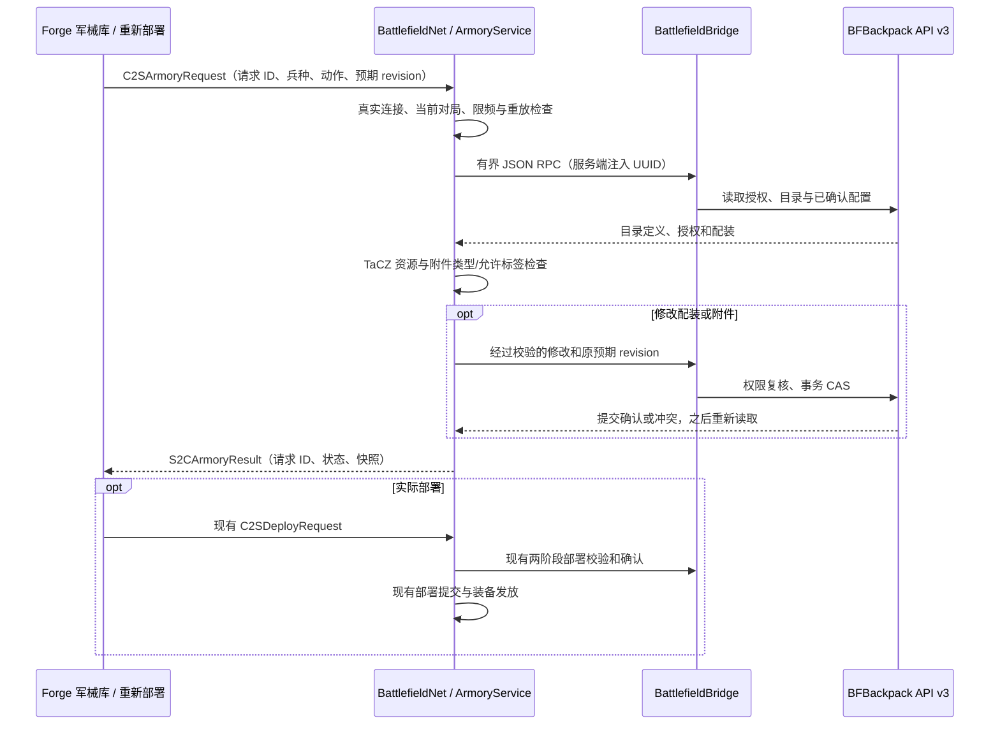
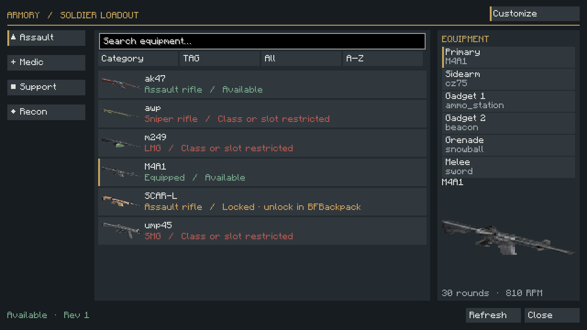
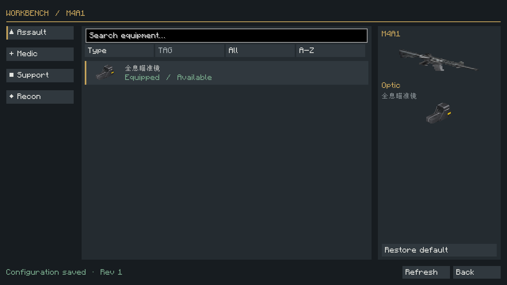
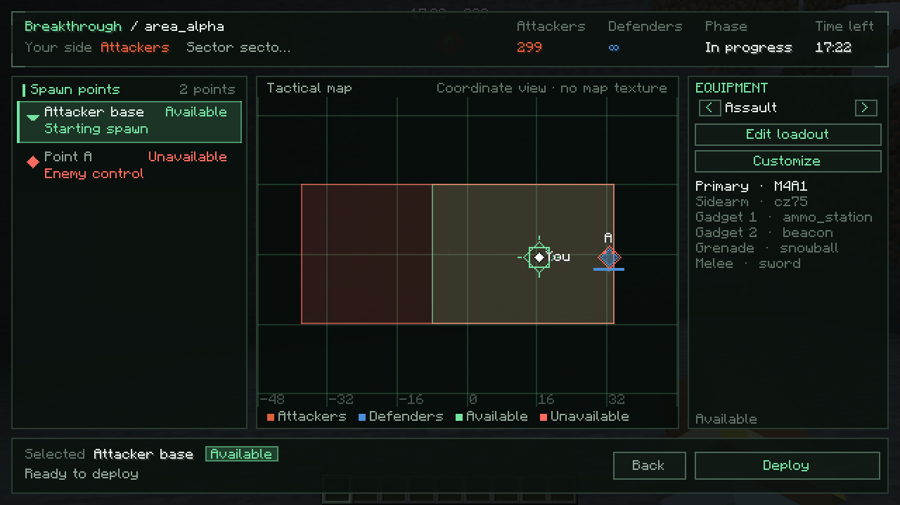

# Battlefield 军械库与部署配装

## 页面结构

| 页面 | 布局与交互 |
| --- | --- |
| 大厅军械库 | K 打开。兵种栏选择突击、医疗、支援或侦察。装备栏选择六个槽位之一。中央目录提供搜索、分类和 TAG 筛选、已解锁与已装备筛选、名称排序和滚动。方向键移动焦点，Enter 选择。 |
| 武器改装台 | 从军械库当前目录卡片或重新部署主武器入口进入。按实际目录和已安装配置提供分类，显示 TaCZ 侧视图、附件图标和已确认的安装状态。恢复默认会删除玩家覆写，使用武器自身默认配置。 |
| 重新部署 | 保留原战区图、据点、出生点、信标及倒计时。士兵面板显示所选兵种、配装摘要、编辑入口和确认状态。离开编辑器会刷新服务端配置及装备验证。 |

窄窗口将兵种栏移到顶端。军械库使用统一颜色和中英文语言资源。重新部署的地图、据点、按钮、状态和提示跟随客户端语言。武器及附件名称使用 BFBackpack 配置。TaCZ 预览使用本地资源侧视图和附件图标，支持显示基础容量及射速。完整的 3D 附件组合预览留作独立验收。

## 数据流

| 功能 | BFBackpack API v3 调用 |
| --- | --- |
| 兵种目录、解锁与权限 | `getCatalog(uuid, type)`。合并四份兵种目录以解释兵种限制，写入校验只查当前兵种。解锁和权限来自条目的 `unlock` 和 `access`。 |
| 兵种配装及失效原因 | `validateLoadout(uuid, type)` 返回保存的六槽配装、revision 以及回退问题。 |
| 选择装备 | `selectEquipment(uuid, type, slot, id, expectedRevision)` |
| 附件选项与当前改装 | `getAttachmentCatalog(uuid, weaponId)` 和 `getWeaponCustomization(uuid, weaponId)` |
| 选择和恢复默认附件 | `selectAttachment(uuid, weaponId, type, id, expectedRevision)` 和 `removeAttachment(uuid, weaponId, type, expectedRevision)` |
| 部署校验 | `getDeploymentLoadout(uuid, type)`，沿用第二阶段运行时校验器与提交逻辑。 |

## revision 与界面状态

兵种配装使用该兵种 revision，附件使用每玩家、每武器的 revision。请求 ID 和目标在发起时绑定。切换兵种时，正在完成的写入只更新原目标，当前界面排队读取新的目标。每个编辑会话同时处理一个请求，避免连续点击使用尚未确认的 revision。未确认的意图以强调色标记，冲突后使用重新拉取的快照，由玩家决定是否再次选择。关闭界面后服务端可以完成已接受的提交，重新打开时创建新的请求并同步。

部署前的界面就绪状态来自当前配置与运行时验证匹配的配装 revision 和目录 revision。部署中的双重确认、幂等和库存提交仍由 LoadoutCoordinator 完成。已打开的编辑页定期重读 BFBackpack，刷新也可手动触发。目录和响应受桥接协议的 512 条目及 128 KiB JSON 上限约束。

## 代码位置

- `client/armory/` 包含共享编辑器、请求状态、主题和本地 TaCZ 图标。
- `client/ui/RedeployScreen.java` 与 `client/net/BattlefieldClientPackets.java` 接入现有重新部署页面。
- `armory/ArmoryView.java`、`net/C2SArmoryRequest.java` 与 `net/S2CArmoryResult.java` 定义客户端视图和消息。
- `loadout/ArmoryService.java` 负责 Forge 服务端会话校验、目录授权和桥接调用。
- `bukkit-bridge/` 调用 API v3 并打包隔离 Bukkit 私有协议类及 Gson，防止 Mohist 同名类链接冲突。
- `assets/battlefield/lang/` 提供中英文界面及结果码文案。
- `src/test/` 和 `bukkit-bridge/src/test/` 覆盖请求编解码、切换兵种、迟到响应、超时、保存失败、CAS 冲突处理及跨兵种目录授权。
- `tools/verify-phase2.ps1` 检查发布 JAR、API 隔离、Bukkit 协议包重定位和示例目录。

## 自动化与 Mohist 验收

| 验证 | 结果 |
| --- | --- |
| Forge Gradle `build` | 131 项 JUnit 测试通过 |
| Bukkit Bridge Maven `clean package` | 14 项 JUnit 测试通过 |
| Forge/TaCZ `runGameTestServer` | 14 项必需 GameTest 通过 |
| API 和发布物 | 示例目录校验通过。Forge 与 Bukkit JAR 分离，协议类在 Bukkit JAR 内重定位。 |
| 实机环境 | Minecraft 1.20.1，Forge 客户端 47.4.16，Mohist 1.20.1-71a84ff7 / Forge 47.4.23，TaCZ 1.1.7-hotfix，BFBackpack API v3 与 SQLite。 |
| 大厅军械库 | 打开目录，锁定的 SCAR-L 无法选用，选用 M4A1 后 revision 增加。切换医疗与突击兵时读到独立主武器。 |
| 武器改装 | 安装、恢复默认、重新安装全息瞄准镜均收到确认。重新打开与重连后读到已保存的设置。 |
| 配装与库存 | 大厅保存前后保留一颗测试钻石。重新部署编辑 AK-47 / M4A1 时库存为空。点击部署后在攻方基地满血复活，主槽恰有一把 M4A1，带 `tacz:sight_552`。离局后恢复一颗原始钻石。 |

实机覆盖单客户端和测试战场的坐标投影地图。多人争用、MySQL、权限撤销与目录热重载并发、真实小队信标部署和全部 GUI Scale 组合仍待实机验收。

### 实机截图

| 大厅军械库 | 武器改装台 | 重新部署 |
| --- | --- | --- |
|  |  |  |
